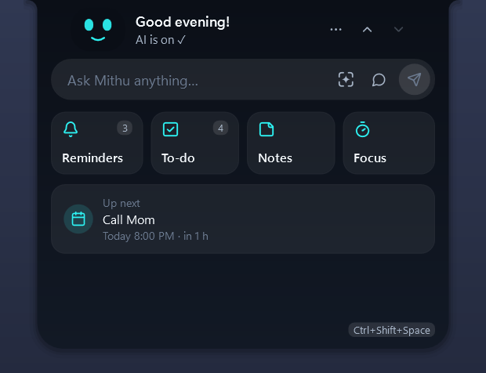
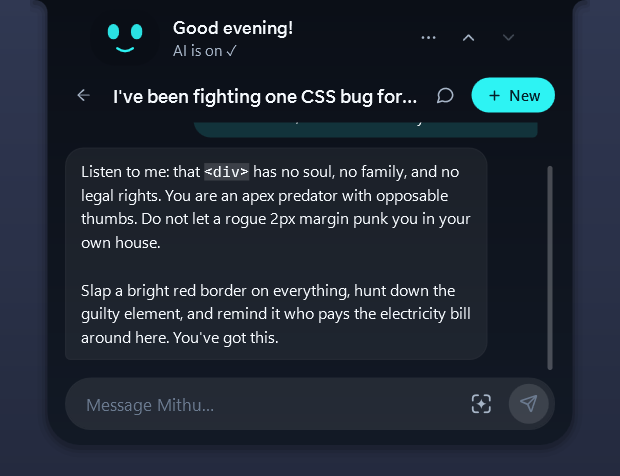
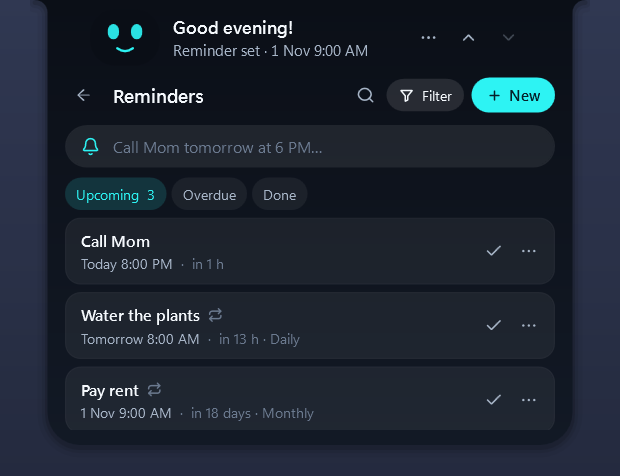
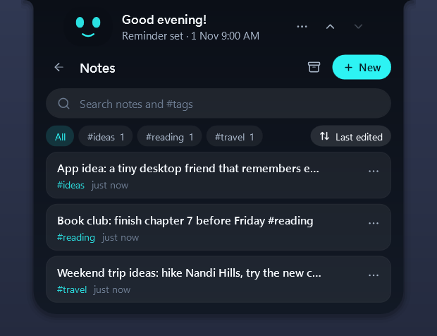
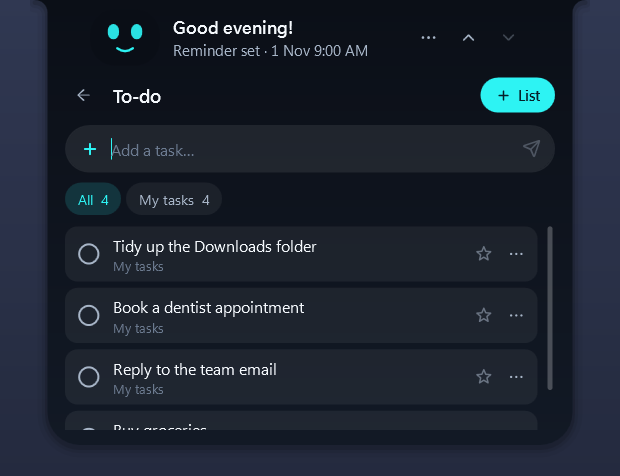
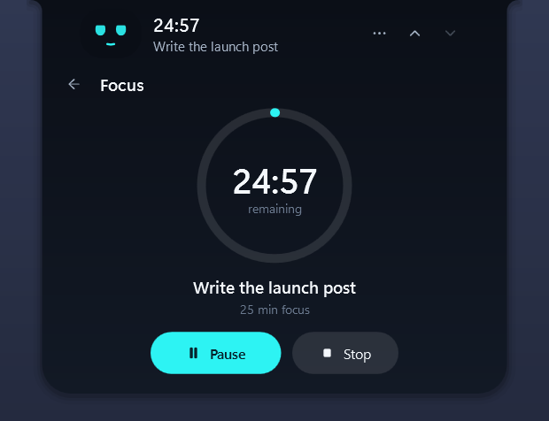
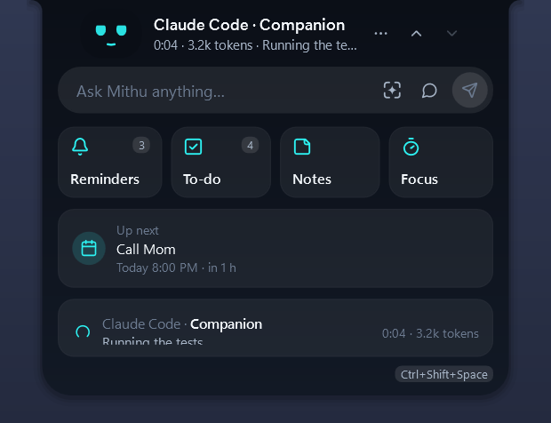
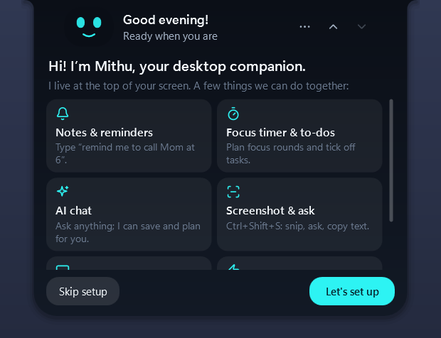
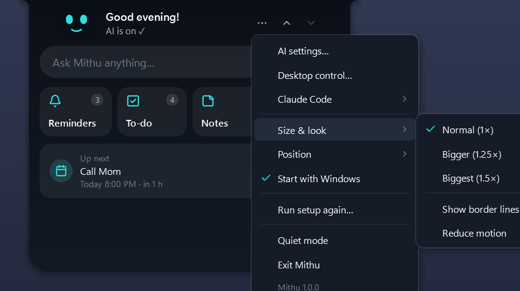

<div align="center">

# Mithu (मिठू)

**Your little desktop dost** — a friendly companion that lives at the top of your Windows screen.

Notes, reminders, to-dos, a focus timer, an AI chat that can see your screen and help on your PC, and live Claude Code status — all behind one cute animated face.



Windows 10 (2004+) / Windows 11 · native C# + WPF on .NET 10 · no Electron, no browser engine · **v1.0.0** · MIT license

</div>

---

## Why Mithu?

- **Always there, never in the way.** Mithu tucks into a small notch at the top of the screen. Click it (or press <kbd>Ctrl</kbd>+<kbd>Shift</kbd>+<kbd>Space</kbd>) and it opens; click anywhere else and it slides back.
- **One box for everything.** Type a note, *"remind me to call Mom at 6"*, or a question for the AI.
- **A face with feelings.** It blinks, thinks, celebrates when you finish a focus round, dozes off when you're away — and the AI can wink at its own jokes.
- **Light.** A native app: about 150 MB of memory, ~0 % CPU when idle, opens in under a second.
- **Private by default.** Everything is stored on your PC. Nothing goes online unless you turn on AI with your own key.

## Screenshots

| | | |
|:-:|:-:|:-:|
|  |  |  |
| **AI chat** — witty, helpful, can act for you | **Reminders** — plain words, repeats, priorities | **Notes** — live formatting, tags, search |
|  |  |  |
| **To-do** — simple lists, no dates | **Focus timer** — plan rounds and breaks | **Claude Code** — live status, time and tokens |
|  |  |   |
| **First-run setup** — name it, add AI, permissions | **Settings menu** | **Compact & notch** |

## Features

### Everyday
- **Quick notes** with `#tags`, a live formatting editor (bold, headings, bullets, checklists), pin, archive, search.
- **Reminders in plain words** — *"tomorrow at 6 pm"*, *"every 2 hours"*, *"weekdays at 9:30"*, *"urgent: …"*. Repeats, priorities, snooze, and Windows notifications even when Mithu is closed.
- **To-do lists** — tasks without dates, starred, done, undo.
- **Focus timer** — choose length, rounds and breaks; the time shows in the header and on the notch.
- **A smart header** — a greeting once per part of the day, then what matters: *"Call Mom · in 20 min"*, *"3 to-dos left"*.

### AI (bring your own key)
- Works with **Claude, OpenAI, Gemini, OpenRouter, Groq**, or free local models with **Ollama / LM Studio**.
- Chats with a personality: friendly, witty when there's room, calm when things are serious.
- **Acts for you:** saves notes, sets reminders, manages to-dos, runs the focus timer.
- **Sees your screen** when you ask (*"what's this error?"*), or snip an area with <kbd>Ctrl</kbd>+<kbd>Shift</kbd>+<kbd>S</kbd>; copy text from any snip; open it in Google Lens. *(Reading images needs a vision model.)*
- **Desktop help:** open apps, arrange windows, find, open and tidy files in folders you allow, set the volume. Moving, renaming and closing always ask first.

### Claude Code companion
- See what Claude Code is doing, live: *"Running the tests · 1:42 · 3.4k tokens"*.
- A chime and a peek when it **finishes** or **needs your OK**; optionally stays open while it works.

### Make it yours
- **Name your companion** — it shows everywhere, and the AI introduces itself by that name.
- Panel sizes (1× / 1.25× / 1.5×), border lines on or off, stick to the top or float anywhere, quiet mode, reduced motion, start with Windows.

## Install

1. Download **`MithuCompanion-win-Setup.exe`** from [Releases](../../releases).
2. Run it — no admin rights needed, .NET is included. Windows may say *"Windows protected your PC"* until the app is code-signed: choose **More info → Run anyway**.
3. The first-run setup walks you through naming your companion, adding AI (optional) and permissions.

Uninstall from *Settings → Apps*. Your notes and reminders stay in `%LOCALAPPDATA%\Mithu` (delete that folder to remove them too).

## Build from source

Requirements: Windows 10/11 and the [.NET 10 SDK](https://dotnet.microsoft.com/download).

```powershell
git clone <this repo>
cd Companion
dotnet run --project src/Mithu.App      # run
dotnet test Mithu.slnx                  # 680+ tests
```

Make the installer (needs `dotnet tool install -g vpk` once):

```powershell
powershell -File scripts\package.ps1    # → artifacts\releases\MithuCompanion-win-Setup.exe
```

Changing the version, building and publishing a release: see [RELEASING.md](RELEASING.md).

## Project layout

| Folder | What's inside |
|---|---|
| `src/Mithu.App` | WPF app: windows, the animated face, pages, view models, themes |
| `src/Mithu.Core` | Pure .NET logic (reminders, focus, AI messages, rules) — no UI |
| `src/Mithu.Infrastructure` | Windows, SQLite, notifications, AI clients, Claude Code hooks |
| `tests/Mithu.Tests` | xUnit tests |
| `docs/` | Architecture, AI, privacy, performance, packaging notes |

## Privacy

- All data stays on your PC (`%LOCALAPPDATA%\Mithu`). No accounts, no tracking.
- AI is **off** until you add a key and agree to what is sent. Your key is encrypted on this PC (Windows DPAPI).
- The AI only reads your notes, screen or clipboard if you allow it — and every screenshot shows in the chat.
- Logs never contain your notes, reminders or messages.

More in [docs/privacy.md](docs/privacy.md) and [docs/ai.md](docs/ai.md).

## License

[MIT](LICENSE) © 2026 Srinath. The name "Mithu" and its face identify this project; forks are welcome under their own name.

## Docs

[Architecture](docs/architecture.md) · [AI](docs/ai.md) · [Packaging & updates](docs/packaging.md) · [Performance](docs/perf.md) · [Privacy](docs/privacy.md) · [Releasing](RELEASING.md)
